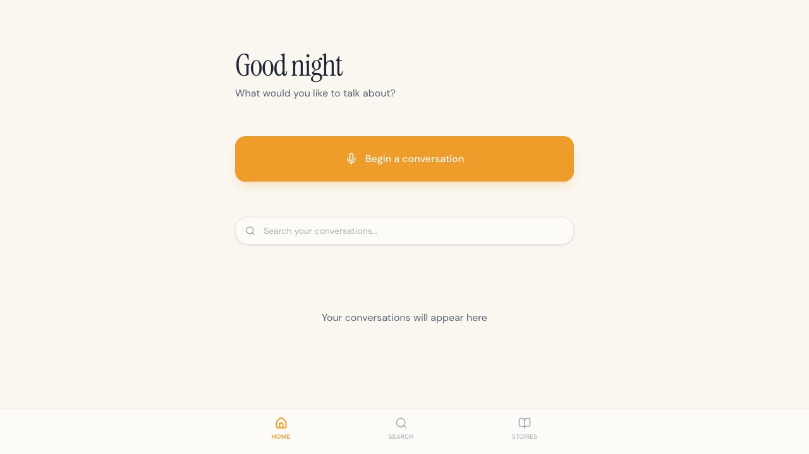
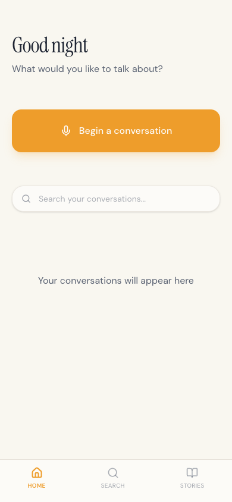
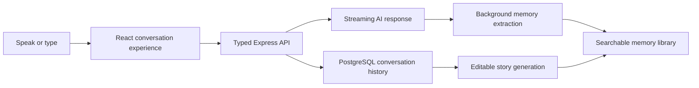

# eKoMe

**A voice-first companion for turning conversations into memories and editable personal stories.**

eKoMe explores a simple idea: remembering should feel more like talking to a thoughtful friend than completing a journal template. A user speaks or types, the conversation streams in real time, useful memories are extracted in the background, and the user can shape the exchange into an editable story.

This is the current employer-reviewable edition of the active eKoMe MVP. Replit agent memory, pasted prompts, duplicate mockups, deployment metadata and all environment values have been removed.



<p align="center">
  
</p>

## Product flow



## What is implemented

- Mobile-first conversation and call-style recording interface.
- Browser audio capture and speech transcription.
- Server-sent event streaming for conversation and story generation.
- Conversation, message, memory, story and story-revision data models.
- Background extraction of structured people, places, events, ideas and goals.
- Configurable story perspective, tone and format with an editable result.
- OpenAPI-first contracts with generated React Query and Zod clients.
- PostgreSQL persistence through Drizzle ORM.
- Shared client/server audio integration packages.

## Stack

- React 19, TypeScript, Vite and Tailwind CSS
- Express 5 and WebSockets/SSE
- PostgreSQL and Drizzle ORM
- OpenAPI, Orval and Zod
- OpenAI-compatible server integration
- pnpm workspaces

## Workspace map

```text
artifacts/ekome/       React product interface
artifacts/api-server/ Express API and AI orchestration
lib/api-spec/         OpenAPI source of truth
lib/api-client-react/ Generated typed client
lib/api-zod/          Generated request/response validation
lib/db/               Drizzle schema and database connection
lib/integrations-*    Browser and server audio/AI adapters
```

## Run locally

Requirements: Node.js 24, pnpm 11 and PostgreSQL.

```bash
corepack enable
pnpm install --frozen-lockfile
cp .env.example .env
pnpm run typecheck
pnpm run dev:api
pnpm run dev:web
```

Provide development values for the services listed in `.env.example`. Never commit them.

## Engineering decisions

- **OpenAPI first:** contracts are defined before implementation and generate both browser hooks and runtime schemas.
- **Streaming interaction:** conversational and story responses use SSE so the interface can update as text arrives.
- **Background memory work:** extraction and conversation metadata updates stay off the critical response path.
- **Editable AI output:** generated stories remain user-controlled and revisions have their own data model.
- **Server-only credentials:** model and database credentials are never bundled into the browser application.

## Current boundary

This is an active single-user MVP, not a production multi-tenant service. Before wider release it still needs product-level authentication and authorization, rate limiting, encrypted data lifecycle controls, abuse monitoring and a formal privacy review. Those limitations are documented deliberately rather than hidden behind a polished demo.
